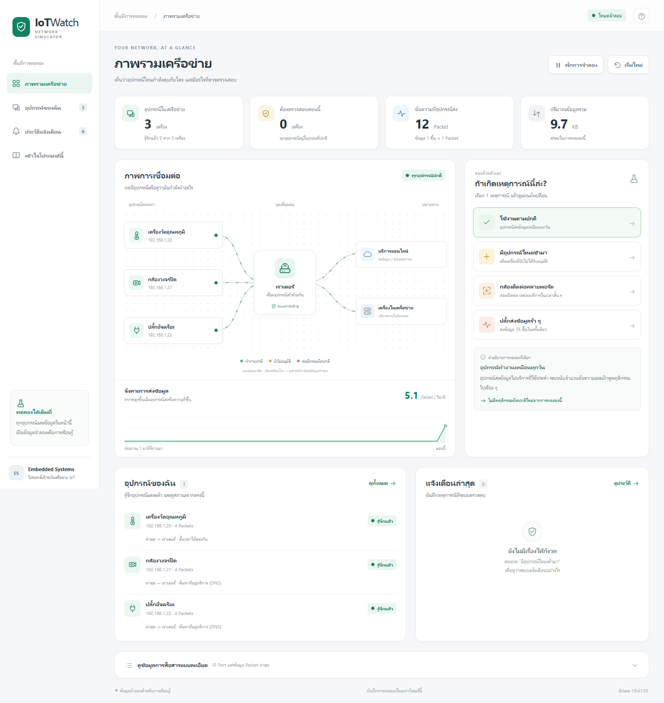
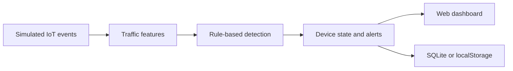

# IoT Watch - Network Security Monitoring Simulator

[**Try the live demo**](https://rawatbuasri4-boop.github.io/iot-network-security-monitor/) - runs in your browser, with no installation or physical hardware required.

A local IoT network security simulator with an interactive Thai-language dashboard, rule-based anomaly detection, and an optional Python/SQLite back end. Explore how a monitoring system identifies unknown devices, port-scan patterns, and traffic bursts without connecting physical hardware.

**Project status:** Working educational prototype using simulated event records. It does not capture live packets, scan devices, or transmit attack traffic. Raspberry Pi deployment and live packet capture are future work.



## Features

- Visualize a simulated network containing a thermostat, camera, and smart plug.
- Trigger three anomaly scenarios: an unknown device, a port-scan pattern, and a traffic burst.
- Inspect devices, approve trusted devices, filter communication records, and review alert history.
- Pause, resume, and reset the simulation. Device approval does not disable anomaly detection.
- Run entirely in a browser with localStorage, or use the Python HTTP API with SQLite event and alert storage.
- Recover device status after suspicious events leave the detection window.

## Technology

| Layer | Implementation |
| --- | --- |
| Dashboard | HTML, CSS, vanilla JavaScript; responsive Thai interface |
| Offline simulation | JavaScript with browser localStorage |
| Back end | Python 3.10+ standard library; ThreadingHTTPServer |
| Storage | SQLite in server mode; localStorage in offline mode |
| Detection | Rules over per-device traffic windows |
| Tests | Python unittest; Node.js assertions |

## Quick start

### Live demo

Open [IoT Watch](https://rawatbuasri4-boop.github.io/iot-network-security-monitor/) and try the scenario buttons. The hosted demo uses the JavaScript simulation engine and browser localStorage. The Python/SQLite back end is available when running the project locally.

GitHub Pages serves the root `index.html`, which opens `static/index.html?demo=1`. The explicit demo flag also supports other static hosts; Pages URLs automatically use browser simulation mode.

### Option 1: Open the dashboard - no installation

Download or clone this repository, then open **OPEN_DASHBOARD.html** in Chrome or Edge. On Windows, you can also double-click **start_simulator.bat**.

This mode generates and processes simulated records in the browser. Data is stored in that browser's localStorage; if storage is blocked, the demo still runs but state will not survive a reload.

### Option 2: Run the Python back end

Install Python 3.10 or newer, open a terminal in the project directory, then run:

```sh
python iot_security_simulator.py --open-browser
```

Open **http://127.0.0.1:8765**. No pip dependencies are required. On Windows, `start_simulator.bat --server` is an alternative. On systems where Python is named `python3`, use that command instead.

Server mode creates `simulator.db` locally. The current prototype resets server data at startup; SQLite storage is not intended as a durable audit log. Offline and server data are separate.

## Try a scenario

1. Start with normal traffic and inspect the three devices in the network map.
2. Select the unknown-device scenario and inspect the new device and alert.
3. Approve the device and confirm the alert remains in history.
4. Select the port-scan or traffic-burst scenario and inspect the affected device.
5. Return to normal traffic and allow the detection window (about 20 seconds) to expire.

## Architecture



The simulator generates source/destination IPs, protocols, destination ports, packet sizes, and timestamps. Detection rules aggregate recent events by device to identify suspicious patterns. Browser and server modes use separate simulation engines with matching scenarios.

## HTTP API

Available only in Python server mode. POST requests use JSON bodies.

| Method | Endpoint | Purpose / example body |
| --- | --- | --- |
| GET | `/api/state` | Read devices, events, alerts, and counters |
| POST | `/api/scenario` | `{"scenario":"new_device"}`; also `normal`, `port_scan`, `traffic_burst` |
| POST | `/api/device/trust` | `{"device_id":"unknown-01"}` |
| POST | `/api/pause` | `{"paused":true}` or `{"paused":false}` |
| POST | `/api/reset` | Reset server simulation data |

The server binds to loopback and is designed for a local demonstration. It has no authentication or production deployment configuration.

## Tests

Python tests use temporary databases and cover detection, approval, pause/resume, window expiry, SQLite writes, and HTTP controls. JavaScript checks cover normal traffic, detection, persistence, reset, throttling, and blocked-storage fallback.

```sh
python -m unittest discover -s tests -v
node tests/test_offline_simulator.cjs
```

Node.js 20+ is needed only to run the JavaScript tests, not to use the dashboard.

## Repository layout

```text
OPEN_DASHBOARD.html            Offline dashboard launcher
index.html                    Hosted demo entry point
iot_security_simulator.py     Python simulation, rules, storage, and HTTP API
start_simulator.bat            Windows launcher
static/                       Dashboard and browser simulation engine
tests/                        Python and JavaScript checks
docs/dashboard-preview.png    Dashboard screenshot
docs/README.th.md              Original Thai user guide
```

## Next steps

- Add an authorized live-capture adapter and evaluate it on a Raspberry Pi.
- Benchmark detection latency and processing throughput using repeatable test data.
- Expand automated browser and HTTP input-validation coverage.
- Separate long-term event retention from simulation resets.

## Author

Rawat Buasri - IoT and Information Engineering student, King Mongkut's Institute of Technology Ladkrabang.

[Thai user guide](docs/README.th.md)
